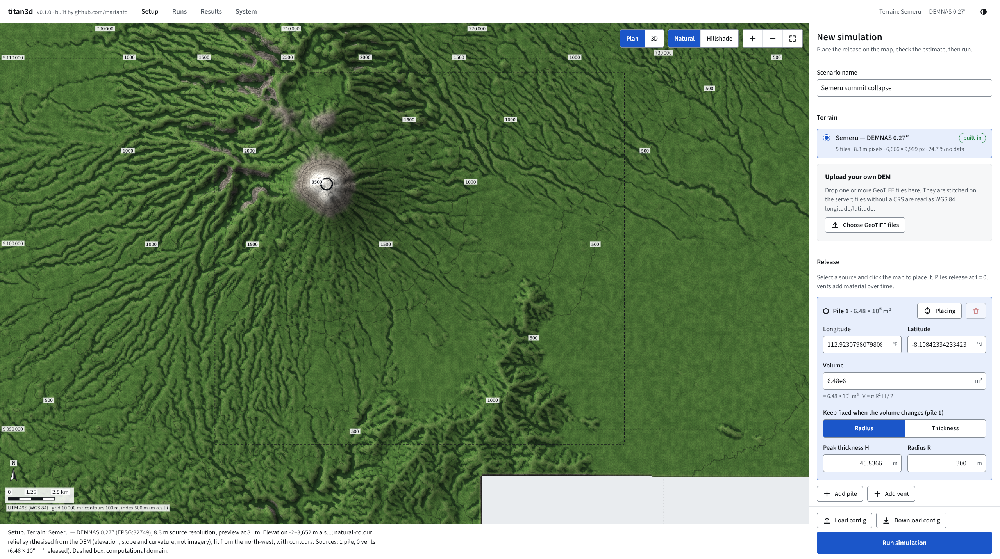
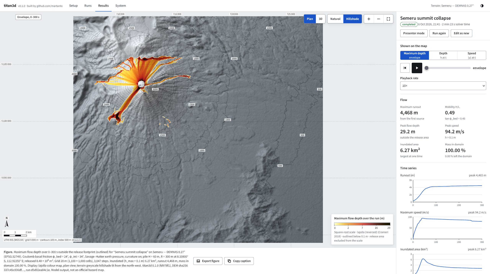
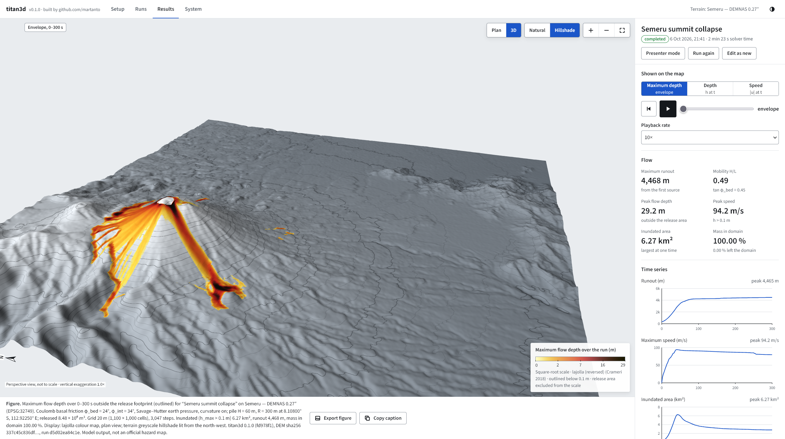
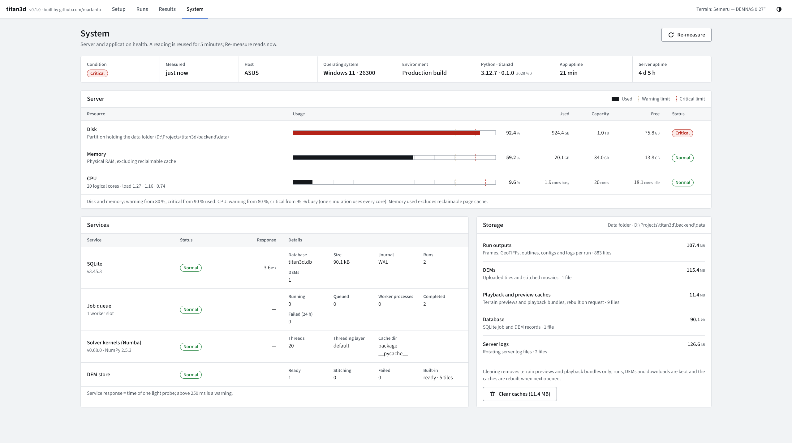

# titan3d

**titan3d** is a Python re-implementation of the [Titan2D](https://github.com/titan2d/titan2d) depth-averaged granular-flow model. It comes with a web app for setting up, running and analysing simulations of volcanic mass flows on real terrain.

```
 DEM tiles ──► stitch + reproject ──► Solver (NumPy/Numba) ──► frames, maxima ──► GeoTIFF · GeoJSON · KML
 (upload)      (rasterio, UTM)        background worker       SQLite progress      3D playback + figures
```

<table>
  <tr>
    <td width="25%" valign="top" align="center">
      <a href="assets/setup.png"></a>
      <br><sub><b>Setup</b></sub>
    </td>
    <td width="25%" valign="top" align="center">
      <a href="assets/results-plan.png"></a>
      <br><sub><b>Results, plan</b></sub>
    </td>
    <td width="25%" valign="top" align="center">
      <a href="assets/results-3d.png"></a>
      <br><sub><b>Results, 3D</b></sub>
    </td>
    <td width="25%" valign="top" align="center">
      <a href="assets/system.png"></a>
      <br><sub><b>System</b></sub>
    </td>
  </tr>
</table>

## Contents

- [Introduction](#introduction)
- [Requirements](#requirements)
- [Installation](#installation)
- [Files to prepare](#files-to-prepare)
- [Running titan3d](#running-titan3d)
- [Deploying behind nginx](#deploying-behind-nginx)
- [Using the web app](#using-the-web-app)
  - [1. Setup](#1-setup)
  - [2. Run](#2-run)
  - [3. Results](#3-results)
  - [Runs, presenter mode and themes](#runs-presenter-mode-and-themes)
  - [System](#system)
- [Parameters](#parameters)
- [Outputs](#outputs)
- [Command line](#command-line)
- [HTTP API](#http-api)
- [Model and numerics](#model-and-numerics)
- [Verification](#verification)
- [Troubleshooting](#troubleshooting)
- [Repository layout](#repository-layout)
- [Development](#development)
- [Roadmap](#roadmap)
- [References](#references)

## Introduction

Titan2D simulates dry granular mass flows, such as block-and-ash flows, debris avalanches and rock avalanches, over a digital elevation model (DEM). It solves the depth-averaged Savage–Hutter equations with Coulomb basal friction.

titan3d keeps the same governing equations and numerics family. It replaces the C++/AMR code with a compact, tested NumPy/Numba solver behind a FastAPI service:

- **For hazard analysts:**
  - place a collapse pile or a vent on a DEM, run a high-resolution scenario, and follow its progress;
  - brief on the result as a scientific figure (UTM grid, scale bar, colourbar, auto-written caption);
  - hand the maxima on as GeoTIFF, GeoJSON or KML.
- **For researchers:**
  - every parameter is explicit and reproducible: YAML configs, provenance (code version, DEM hash) on every run;
  - mass balance is reported;
  - the core is plain Python with verification tests.
- **For outreach:** 3D playback in real time, and a presenter mode with plain-language labels.

Results are model output, not official hazard maps.

More documentation is in the [wiki](wiki/Home.md): [Titan2D model](wiki/Titan2D.md), [Architecture](wiki/Architecture.md), [Backend](wiki/Backend.md), [Frontend](wiki/Frontend.md) and [API Reference](wiki/API-Reference.md).

The [terminology guide](wiki/Terminology.md) explains Adaptive Mesh Refinement
(AMR), grid spacing versus numerical order, solver acronyms, physical parameters
and comparison metrics such as runout, IoU and RMSE.

## Requirements

| What | Version | Notes |
|---|---|---|
| [uv](https://docs.astral.sh/uv/) | 0.11+ | Installs Python 3.12 and every backend dependency. No separate Python needed. |
| [Node.js](https://nodejs.org/) | 22+ (with npm) | Only to build the web UI (once, and after frontend changes). |
| OS | Windows 10/11, Linux, macOS | Rasterio and Numba ship binary wheels, so GDAL and a C compiler are not required. |
| CPU / RAM | 4+ cores, 8 GB+ | The solver uses every core. A 20 m domain of about 1 million cells needs about 150 MB of solver memory, and frames are written to disk. |
| Browser | Current Chrome, Edge, Firefox or Safari | WebGL 2 is required for the map and 3D view. |
| Disk | ~1 GB per large study | Stitched DEMs, plus per-run frames and outputs in `data/`. |

## Installation

```bash
git clone https://github.com/martanto/titan3d.git
cd titan3d

# 1. web UI (build once)
cd frontend
npm ci
npm run build

# 2. backend (creates backend/.venv with Python 3.12 and all dependencies)
cd ../backend
uv sync
```

Check the installation:

```bash
uv run titan3d --version
uv run pytest -q          # 101 tests, about 40 s
```

## Files to prepare

titan3d needs only a DEM. Everything else is set in the app or in a YAML file.

### DEM (required)

- **Format:** GeoTIFF, one band holding elevation in metres a.s.l. Integer or float types both work.
- **CRS:**
  - Tiles with an embedded CRS are used as-is. Tiles in different CRSs are warped to the first tile's CRS.
  - Tiles without a CRS are accepted only if their bounds are longitude/latitude; they are then read as WGS 84. Indonesian DEMNAS tiles ship this way.
- **Tiles:** any number of adjacent tiles. They are mosaicked on the server, and gaps stay as "no data".
- **No data:** declared nodata values, NaN, and sentinels below −1000 m (for example −9999 or −32767) are treated as missing.
- **Resolution:** anything from about 5 m to 90 m. The grid spacing you run at is chosen separately (minimum 10 m).
- **Coverage:** the computational domain is cut around the release and must lie inside the DEM. More than 0.5 % missing data is rejected with a message naming the side.

You can supply the DEM in two ways:

1. **Built-in DEM:** put tiles in `dem/` at the repository root. They are registered as "Semeru — DEMNAS 0.27″" (the name can be changed with `TITAN3D_BUILTIN_DEM_NAME`) and stitched once on first start, which takes about 20 s for 5 tiles. `dem/` is git-ignored; the Semeru DEMNAS tiles come from Badan Informasi Geospasial (BIG).
2. **Upload in the app:** Setup → Terrain → *Choose GeoTIFF files* (or drag and drop several files).

### Scenario file (optional)

A YAML file with the same fields as the Setup form (see [Parameters](#parameters)). Create a commented template with `uv run titan3d init-config -o scenario.yaml`. You can load it in the app (*Load config*) or run it from the command line.

## Running titan3d

```bash
cd backend
uv run titan3d serve                     # http://127.0.0.1:8000  (UI + API)
uv run titan3d serve --host 0.0.0.0      # reachable from other machines on the network
```

Open http://127.0.0.1:8000 in a browser. API documentation is at http://127.0.0.1:8000/api/docs.

- **Settings:** set them as `TITAN3D_*` environment variables or in `backend/.env`. The data folder, concurrency, upload limits and optional basic auth (`TITAN3D_BASIC_AUTH_USER` / `TITAN3D_BASIC_AUTH_PASSWORD`) are covered in [deploy/README.md](deploy/README.md).
- **Server restarts:** runs execute in background worker processes. A run that is in progress when the server stops is marked *interrupted* and can be restarted with **Run again**.
- **Docker and services:** Docker is optional. Docker Compose and Windows/Linux service setups are also in [deploy/README.md](deploy/README.md).

## Deploying behind nginx

For a shared server, run titan3d on `127.0.0.1:8000` and put nginx in front for TLS, large uploads, static caching and (optionally) basic auth. A complete reference configuration is in [deploy/nginx.conf.example](deploy/nginx.conf.example).

1. **Build and run the app** on the server (Linux example, repository in `/opt/titan3d`):
   ```bash
   cd /opt/titan3d/frontend && npm ci && npm run build
   cd /opt/titan3d/backend && uv sync
   ```
   Keep `uv run titan3d serve` (bound to 127.0.0.1) running with the systemd unit from [deploy/README.md](deploy/README.md).
2. **Install the site:**
   ```bash
   sudo cp /opt/titan3d/deploy/nginx.conf.example /etc/nginx/sites-available/titan3d
   sudo ln -s /etc/nginx/sites-available/titan3d /etc/nginx/sites-enabled/
   # edit server_name, certificate paths and /opt/titan3d paths, then:
   sudo nginx -t && sudo systemctl reload nginx
   ```
3. **TLS:** `sudo certbot --nginx -d titan3d.example.org`. For an HTTP-only intranet, use the commented `listen 80` server at the end of the example instead.
4. **Authentication (pick one):**
   - nginx: `sudo htpasswd -c /etc/nginx/titan3d.htpasswd <user>`, then uncomment `auth_basic` in the example;
   - or the app: set `TITAN3D_BASIC_AUTH_USER` and `TITAN3D_BASIC_AUTH_PASSWORD`.

   `/api/health` stays open either way.

What the example takes care of:

| Setting | Why |
|---|---|
| `client_max_body_size 4g`, `client_body_timeout 600s`, `proxy_request_buffering off` | Multi-file DEM uploads (up to 1 GB per file by default) stream straight to the app. |
| `proxy_read_timeout 600s` | The first request for a result or preview bundle builds it, which can take a while for large runs. |
| `location /assets/` with `immutable` caching; `location /` with `try_files … /index.html` and `no-cache` | nginx serves the built UI directly: hashed bundles are cached forever, while `index.html` always revalidates after a rebuild. This is optional, because the app can serve `frontend/dist` itself. |
| `location /api/` → `http://127.0.0.1:8000` | API, uploads and downloads go to the app. |
| `gzip on` for static types | API JSON is already gzipped by the app, and playback bundles are served pre-compressed; nginx does not re-compress them. |

titan3d must be served at the root of a domain or subdomain. A sub-path such as `/titan3d/` is not supported.

## Using the web app

The top bar has four views: **Setup**, **Runs**, **Results** and **System**. The left side is always a map figure with a UTM graticule, a scale bar and north arrow (lower left), and a caption that describes exactly what is shown.

Map tools are in the upper right:
- **Plan / 3D:** the map view or a perspective view.
- **Natural / Hillshade:** a natural-colour relief synthesised from the DEM (not imagery), or a greyscale hillshade.
- **Zoom in / out, Reset view.**

Interaction: drag to pan (plan) or orbit (3D), scroll to zoom, and hover or tap to read coordinates and elevation.

### 1. Setup

Work from top to bottom:

1. **Scenario name:** used in captions, file names and the run list.
2. **Terrain:**
   - Choose a DEM. Each one shows its tile count, pixel size, extent and percentage of missing data.
   - Or upload tiles: drop GeoTIFFs, name the DEM, then press *Upload*. A progress bar shows the upload, then the stitching. The new DEM is selected when ready, and stitching errors are shown in plain language.
3. **Release:**
   - **Pile:** a paraboloid released at t = 0. Set its thickness and radius, or type a volume (`2e7`, `8 500 000`) and choose which of the two stays fixed.
   - **Vent:** a flux source that adds material over time.
   - Press **Place** on a source, then click the map to move it. Sources can also be typed as longitude/latitude.
4. **Computational domain:**
   - Distances west/east/south/north of the first source, in km. The dashed box on the map shows the domain.
   - Keep the expected runout path inside it. Material that leaves is counted as outflow.
5. **Material:** rheology (Coulomb or Voellmy), friction angles, earth-pressure model and the curvature term. See [Parameters](#parameters).
6. **Resolution and time:**
   - Grid spacing presets: **Quick 40 m**, **Standard 20 m**, **Fine 10 m**, or a custom value. Halving Δx costs about 8× the runtime.
   - Simulated time and output interval. *Numerics* holds precision, kernels and the Courant number.
7. **Estimate:** grid size, cell count, solver memory, released volume and a runtime class (seconds, minutes, tens of minutes, hours). It updates as you edit.
8. **Load config / Download config:** reload or save the scenario as YAML.
9. **Run simulation:**
   - The scenario is validated against the DEM before it is queued. For example, a domain outside the DEM's coverage is rejected with the reason.
   - The draft is kept in the browser between visits.

### 2. Run

After **Run simulation** the app switches to the progress view. This is the loading view for long runs:

- **Phases:** queued → cutting and reprojecting the domain → compiling solver kernels (first run only, about 10 s) → solving → writing outputs. Each phase is shown as it happens.
- **Progress:**
  - simulated time `t` of `t_end` with a progress bar;
  - elapsed time and an estimate of the time remaining;
  - number of time steps.
- **Flow so far:**
  - runout, maximum speed, maximum depth, inundated area;
  - mass in the domain and the fraction that left it;
  - live runout and speed curves.
- **Cancel run:** stops the solver within about a second.

You can close the page or start another setup. The run continues on the server and appears under **Runs**. By default one run executes at a time and further runs queue.

### 3. Results

A finished run opens on the **briefing figure**: the maximum flow depth over the whole run, in plan view on a hillshade.

- **Shown on the map:**
  - *Maximum depth* (envelope, Crameri lajolla), *Depth* at time t (batlow) or *Speed* at time t (imola).
  - Every colourbar states its units, its scale (square-root for depth) and the colour-map citation.
  - The release footprint is masked from the envelope and outlined, because the t = 0 pile is not flow depth.
  - The flow edge is outlined at the threshold (0.05 m for depth, 0.1 m for the envelope).
- **Playback:**
  - Play/pause, step and the time slider; rates from 1× (real time) to 40×. Playback holds on the final deposit.
  - Keyboard: **Space** plays/pauses, **← / →** step one frame.
- **Flow readouts:** runout from the first source; mobility **H/L** shown next to tan φ_bed; peak depth and speed; inundated area (h > 0.1 m); mass in the domain and outflow.
- **Time series:** runout, maximum speed and inundated area against time, with axes. Click to seek.
- **Figure and data:**
  - **Export figure** saves a PNG of the current view with furniture, colourbar and caption.
  - **Copy caption** copies the caption, which includes all parameters and provenance.
  - Downloads: see [Outputs](#outputs).
- **Display:**
  - Vertical exaggeration (3D, always stated on the map).
  - Thin-flow exaggeration (optional, always badged).
  - Contours (labelled index contours in m a.s.l.).
  - Playback detail (320/640/1024 cells per side, for the browser only; downloads keep full resolution).
- **Parameters, Provenance, Model notes:**
  - the exact inputs;
  - titan3d version and git commit, DEM SHA-256, NumPy/Numba versions;
  - the model's limits.
- **Run again** (same scenario) or **Edit as new** (copy to Setup).

### Runs, presenter mode and themes

- **Runs:**
  - Lists all runs with status, live progress, grid and solver time.
  - Actions: open, run again, delete (with a confirm step).
  - Failed or interrupted runs show the error and a link to the solver log.
- **Presenter mode** (in Results):
  - hides the panel and switches to the 3D view (vertical exaggeration 1.5×, badged);
  - plain-language legend ("Flow thickness", "Deepest flow reached");
  - real-time, 2× and 5× playback; **Esc** exits.
- **Theme:** the top-right button cycles system / light / dark.

### System

The **System** page shows server and application health. It is not realtime: one reading is reused for 5 minutes, and **Re-measure** reads again.

- **Summary:** overall condition (the worst status below), when it was measured, host, OS, Python and titan3d versions, app and server uptime.
- **Server:**
  - disk (the partition holding the data folder), memory (physical RAM, excluding reclaimable cache) and CPU (utilisation and load average where the OS reports it);
  - each has a usage bar with the warning and critical limits marked;
  - limits: disk and memory warn from 80 % and are critical from 90 %; CPU warns from 80 % and is critical from 95 %.
- **Services:**
  - SQLite (probe time, size, journal mode);
  - the job queue (running, queued, worker processes, failed in the last 24 h);
  - the Numba solver kernels (version, threads);
  - the DEM store (ready, stitching, failed, built-in).
- **Storage:** sizes of run outputs, DEMs, the database, logs and the regenerable caches. **Clear caches** removes only terrain previews and playback bundles, after a confirm step; they are rebuilt on request.

## Parameters

All parameters exist in the Setup form, in the YAML file and in the API (`ScenarioRequest`). Defaults describe a summit collapse at Semeru.

### Release sources

| Field | Default | Range | Meaning |
|---|---|---|---|
| `piles[].lon`, `.lat` | 112.9225, −8.1080 | WGS 84 | Pile centre |
| `piles[].height` | 60 m | 0–1000 | Peak thickness H of the paraboloid `h = H(1 − r²/R²)` |
| `piles[].radius` | 300 m | 0–10 000 | Radius R. Volume = π R² H / 2 (8.5 × 10⁶ m³ by default) |
| `flux_sources[].lon`, `.lat` | — | WGS 84 | Vent centre |
| `flux_sources[].radius` | 100 m | 0–5000 | Footprint radius (paraboloid profile) |
| `flux_sources[].influx` | 1 m/s | 0–50 | Peak extrusion rate at the centre (depth added per second) |
| `flux_sources[].start`, `.duration` | 0 s, 60 s | ≥ 0, > 0 | Active interval. Volume = π R² · influx · duration / 2 |
| `flux_sources[].speed`, `.direction_deg` | 0 m/s, 0° | 0–200, 0–360 | Initial velocity of the added material (azimuth clockwise from north) |

At least one pile or vent is required, and at most 32 sources.

### Domain

| Field | Default | Meaning |
|---|---|---|
| `domain.west_km`, `east_km`, `south_km`, `north_km` | 6, 16, 14, 6 | Distances from the anchor (the first source, unless `center_lon`/`center_lat` are set) in km. The domain is reprojected to the anchor's UTM zone. |
| `domain.center_lon`, `center_lat` | unset | Optional explicit anchor |

### Material

| Field | Default | Range | Meaning and guidance |
|---|---|---|---|
| `material.rheology` | `coulomb` | `coulomb` / `voellmy` | Basal resistance law |
| `material.phi_bed_deg` | 24° | 0–60 | **Basal friction angle.** Controls runout: a Coulomb flow travels until its mobility H/L falls to about tan φ_bed. Long-runout block-and-ash flows usually need much lower values than the default. Calibrate against mapped deposits. |
| `material.phi_int_deg` | 34° | 0–60 | Internal friction angle, used by the Savage–Hutter earth-pressure coefficient |
| `material.mu` | 0.12 | 0–1 | Voellmy dry-friction coefficient (Voellmy only) |
| `material.xi` | 1000 m/s² | 0–10 000 | Voellmy turbulence coefficient; lower values mean more velocity-dependent drag (Voellmy only) |
| `material.earth_pressure` | `savage-hutter` | `savage-hutter` / `hydrostatic` | Active/passive k from φ_int and φ_bed, or k = 1 |
| `material.curvature` | `true` | | Adds the centripetal bed-curvature term to the normal stress (more friction in concave bends) |

### Resolution, time and numerics

| Field | Default | Range | Meaning |
|---|---|---|---|
| `numerics.dx` | 20 m | 10–500 | Grid spacing. Presets 40 / 20 / 10 m. Runtime grows about 8× per halving. |
| `t_end` | 300 s | up to 86 400 | Simulated duration |
| `output_every` | 2 s | 0.5–3600 | Interval between saved frames (at most 2000 frames) |
| `numerics.cfl` | 0.4 | 0.05–0.9 | Courant number of the adaptive time step |
| `numerics.precision` | `float64` | `float64` / `float32` | float32 is about 2× faster with half the memory; float64 is the reference |
| `numerics.backend` | `numba` | `numba` / `numpy` | Compiled parallel kernels, or the NumPy reference (about 13× slower) |
| `numerics.h_dry` | 0.001 m | | Depth below which velocity is set to zero |
| `name`, `dem_id` | | | Scenario name and DEM identifier (`semeru` for the built-in DEM) |

## Outputs

Each run is stored in `<project root>/data/runs/<run id>/`, alongside `backend/`.
The default is independent of the working directory; `TITAN3D_DATA_DIR` overrides it.
For existing installations, see [moving existing data](deploy/README.md#moving-existing-data).

Run artifacts:

| File | Content | Use |
|---|---|---|
| `max_depth.tif` | Maximum flow depth over every time step (m), full resolution, local UTM | GIS / QGIS |
| `max_speed.tif` | Maximum speed over every time step (m/s) | GIS |
| `inundation.geojson` | Outline of cells with h_max > 0.1 m, WGS 84, with area | GIS / web maps |
| `inundation.kml` | The same outline for Google Earth | Briefings |
| `scenario.yaml` | The exact configuration, reloadable | Reproducibility |
| `summary.json` | Frames, steps, wall time, peak values, runout, area, mass balance | Reports |
| `run.log` | Solver log | Diagnosis |
| `frames/NNNN.npz` | Depth and speed per output time (float32) | Further analysis in Python |
| `bundle_<N>.json.gz` | Quantised playback bundle for the browser | Web app |

All except the frames and bundles can be downloaded from the Results panel.

## Command line

```bash
cd backend
uv run titan3d serve [--host 127.0.0.1] [--port 8000] [--reload]
uv run titan3d init-config -o scenario.yaml
uv run titan3d run [--config scenario.yaml] [--dem PATH] [--dx 20] [--backend numba|numpy] [--precision float64|float32] [-o OUT]
uv run titan3d stitch-dem TILES_OR_DIRS... -o mosaic.tif
uv run titan3d openapi -o openapi.json
```

`run` without `--config` runs the default Semeru scenario. `--dem` accepts a mosaic GeoTIFF or a folder of tiles. Output goes to `data/runs/cli-<timestamp>/` unless `-o` is given, and progress lines are printed while it runs.

## HTTP API

The web app uses a JSON API under `/api`. It is documented interactively at `/api/docs`, and the schema is committed as [backend/openapi.json](backend/openapi.json).

| Endpoint | Purpose |
|---|---|
| `GET /api/health` | Status and version |
| `GET/POST /api/dems`, `GET/DELETE /api/dems/{id}`, `GET /api/dems/{id}/preview` | List, upload (multipart, several files), inspect, delete, terrain preview |
| `POST /api/simulations`, `GET /api/simulations[/{id}]` | Queue a scenario, list runs, progress and provenance |
| `GET /api/simulations/{id}/frames` | Per-frame statistics |
| `POST /api/simulations/{id}/cancel`, `/duplicate`, `DELETE /api/simulations/{id}` | Run control |
| `GET /api/simulations/{id}/result`, `/files/{name}` | Playback bundle, downloadable outputs |
| `GET /api/scenarios/default`, `/presets`, `POST /estimate`, `/export`, `/import` | Defaults, presets, cost estimate, YAML |
| `GET /api/system[?refresh=true]`, `POST /api/system/caches/clear` | System health (cached 5 min), clear regenerable caches |

## Model and numerics

Depth-averaged mass and momentum conservation on a bed `b(x, y)`:

```
h_t   + (hu)_x + (hv)_y                          = S_h
(hu)_t + (hu² + ½ k g h²)_x + (huv)_y            = −g h b_x − F_x
(hv)_t + (huv)_x + (hv² + ½ k g h²)_y            = −g h b_y − F_y
```

- **Basal resistance:** Coulomb `|F| = h g_eff tan φ_bed` (Titan2D default) or Voellmy `|F| = h g_eff μ + g|u|²/ξ`.
- **Bed curvature:** `g_eff = cosθ (g + u·∇∇b·u)`, clamped at ≥ 0.
- **Earth pressure:** `k` = 1 (hydrostatic), or Savage–Hutter active (spreading) / passive (converging).
- **Sources:** paraboloid piles at t = 0; flux sources integrated exactly over each time step.

Numerics:

- Finite volumes on a uniform UTM grid.
- Grid spacing describes cell size; numerical order describes the method's
  expected accuracy scaling. Adaptive time stepping and the active window do
  not change cell sizes. See [mesh terminology](wiki/Terminology.md#mesh-and-resolution).
- MUSCL reconstruction (minmod) of depth, bed and velocity.
- Hydrostatic reconstruction (Audusse et al., 2004) for a well-balanced bed term with h ≥ 0. Depth and bed are reconstructed separately, so thin flows are not trapped on steep slopes (Delestre et al., 2012).
- Rusanov flux; SSP-RK2 with an adaptive CFL time step; implicit friction stopping step.
- **Active window:** only the bounding box of cells holding material is computed. This is exact, because dry cells carry no flux.
- **Kernels:** Numba (parallel) or NumPy, in float64 or float32.
- **Outflow accounting:** in-domain volume plus outflow equals released volume.

**Performance:** the default Semeru domain (22 × 20 km at 20 m, 1,100 × 1,000 cells) simulates 300 s in about 85 s on a 20-thread laptop CPU.

## Verification

The [executed Colima solver comparison](docs/COLIMA-COMPARISON.md) runs official
Titan2D 4.2.0 in Docker against titan3d at 10, 5 and 2.5 m. It includes reproducible
depth/difference maps, speed/runout/volume curves and quantitative metrics. The
5 m run has close final runout but fails the footprint-overlap screening criterion;
this does not establish numerical equivalence or field validation.

`uv run pytest` in `backend/` runs 101 tests (one more real-DEM test is opt-in with `TITAN3D_REAL_DEM=1`):

| Test | Result |
|---|---|
| Lake at rest over a bump | stays at rest, \|hu\| < 1e-10 |
| Pile on a 10° slope, φ_bed = 20° | does not move |
| Symmetric pile on an inclined plane | symmetric to 1e-10 |
| Mass balance with outflow | in-domain + outflow = released, 1e-5 |
| Active window vs full domain | bit-identical |
| Numba vs NumPy | agree to 1e-10; float32 within tolerance |
| Curvature on a plane / cylinder | 0 / g + u²/R |
| Flux source volume and timing | exact to 1e-12 |
| DEM stitching, CRS handling, coverage checks | synthetic tiles |
| SQLite jobs (lifecycle, concurrency, recovery) and YAML round trip | pass |
| API end to end (upload → run in a worker → downloads) | real worker processes |

## Troubleshooting

| Symptom | Cause and fix |
|---|---|
| "The titan3d server is not reachable" | Start `uv run titan3d serve` in `backend/`. |
| UI shows "frontend build not found" / API only | Run `npm ci && npm run build` in `frontend/`. |
| "No terrain yet" | No built-in tiles in `dem/`. Add them, or upload tiles in Setup. |
| Upload fails: "CRS missing and bounds are not longitude/latitude" | Add a CRS to the GeoTIFF (for example `gdal_edit.py -a_srs EPSG:32749 tile.tif`). |
| "…% of the domain has no elevation data" | Shrink the domain extents on the named side, or use a DEM that covers the runout path. |
| The first run waits in "Compiling solver kernels" | Numba compiles once (about 10 s) and caches the result. |
| A run shows *interrupted* | The server stopped during the run. Press **Run again**. |
| Very short runout | φ_bed is too high for the case. Lower it (H/L ≈ tan φ_bed). |
| 3D view blank | The browser lacks WebGL 2. Use a current Chrome, Edge or Firefox. |

## Repository layout

```
backend/                FastAPI service and solver (uv project, package titan3d)
  src/titan3d/core/     solver, numerics, rheology, curvature, sources, DEM, scenario, export (no web deps)
  src/titan3d/api/      routes → controllers → core; schemas; background worker and dispatcher
  src/titan3d/db/       SQLite job and DEM tracking
  tests/                pytest suite
  openapi.json          API schema (checked by tests)
frontend/               Vite + TypeScript + three.js + Tailwind CSS v4 web app
data/                   runtime database, uploaded DEMs, runs and logs (local only, git-ignored)
dem/                    built-in DEM tiles (local only, git-ignored)
deploy/                 how to run (uv, service, nginx example, optional Docker)
docs/                   plan and design reviews; PRODUCT.md and DESIGN.md hold product and design context
wiki/                   Home, Titan2D, Architecture, Backend, Frontend, API Reference
```

## Development

```bash
# backend (from backend/)
uv run ruff check --fix src/ && uv run ruff format src/
uvx ty check src/
uv run pytest
uv run titan3d serve --reload

# frontend (from frontend/), with the backend running on :8000
npm run dev          # http://localhost:5173, proxies /api
npm run gen:api      # regenerate API types after backend schema changes
npm run build
```

CI (`.github/workflows/ci.yml`) runs the backend lint, type check and tests, and the frontend type check and build.

## Roadmap

Planned extensions, to be implemented one by one in the order below. Each
Markdown plan contains a scope, implementation checklist and completion criteria.
The plans are written; feature implementation has not started.

| Order | Roadmap item | Plan | Implementation |
|---|---|---|---|
| 1 | Adaptive mesh refinement | [AMR plan](docs/roadmap/01-adaptive-mesh-refinement.md) | Next |
| 2 | Two-phase (Pitman–Le) flows | [Two-phase plan](docs/roadmap/02-two-phase-flows.md) | Pending |
| 3 | Internal-friction shear term | [Internal-friction plan](docs/roadmap/03-internal-friction-shear.md) | Pending |
| 4 | Erosion and entrainment | [Entrainment plan](docs/roadmap/04-erosion-entrainment.md) | Pending |
| 5 | Probabilistic hazard maps from parameter sweeps | [Parameter-sweep plan](docs/roadmap/05-probabilistic-maps.md) | Pending |

Start with [AMR, step 1](docs/roadmap/01-adaptive-mesh-refinement.md#implementation-plan).
Finish and validate each item before starting the next. Track implementation
progress in these checklists and record completed work in the daily changelog.

## References

- Patra, A. K., Bauer, A. C., Nichita, C. C., Pitman, E. B., Sheridan, M. F., Bursik, M., et al. (2005). Parallel adaptive numerical simulation of dry avalanches over natural terrain. *Journal of Volcanology and Geothermal Research*, 139, 1–21.
- Savage, S. B., & Hutter, K. (1989). The motion of a finite mass of granular material down a rough incline. *Journal of Fluid Mechanics*, 199, 177–215.
- Audusse, E., Bouchut, F., Bristeau, M.-O., Klein, R., & Perthame, B. (2004). A fast and stable well-balanced scheme with hydrostatic reconstruction for shallow water flows. *SIAM Journal on Scientific Computing*, 25(6), 2050–2065.
- Delestre, O., Cordier, S., Darboux, F., & James, F. (2012). A limitation of the hydrostatic reconstruction technique for shallow water equations. *Comptes Rendus Mathématique*, 350, 677–681.
- Crameri, F. (2018). Scientific colour maps. Zenodo. doi:10.5281/zenodo.1243862
- Crameri, F., Shephard, G. E., & Heron, P. J. (2020). The misuse of colour in science communication. *Nature Communications*, 11, 5444.
- Titan2D: https://github.com/titan2d/titan2d
- DEMNAS: Badan Informasi Geospasial (BIG), Indonesia. https://tanahair.indonesia.go.id/demnas
