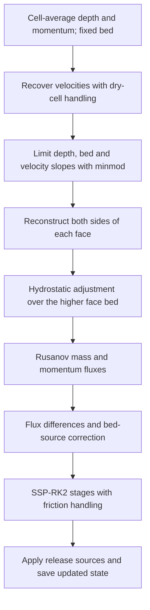

# MUSCL reconstruction in titan3d

MUSCL (Monotonic Upstream-centered Schemes for Conservation Laws) estimates
values at cell faces from values stored inside neighbouring cells. This guide
follows the uniform-grid implementation in
[`numerics.py`](../backend/src/titan3d/core/numerics.py), particularly `minmod`,
`velocity`, `sweep` and `rhs_block`. The Numba kernels implement the same scheme.

Reconstruction is one part of the finite-volume update. It does not change cell
size, move the mesh, or advance time by itself.

## 1. Start from cell averages

The evolving conserved state is depth and two components of depth-integrated
momentum:

$$
\mathbf{U}_i=(h_i,\,h_i u_i,\,h_i v_i).
$$

Here `h` is depth in metres, `u` and `v` are velocities in m/s, and `b` is fixed
bed elevation in metres. Arrays use `[j, i] = [y, x]`. For the explanation below,
consider a row of square cells of width $\Delta x$, increasing towards east.

The stored depth is a cell average, not a measurement at its eastern edge.
A first-order reconstruction would use that same value at both edges. MUSCL
instead builds a limited straight-line profile within each cell.

The code recovers velocity from momentum only where $h>h_{dry}$; otherwise it
sets velocity to zero. It reconstructs `h`, `b`, normal velocity and tangential
velocity separately. The earth-pressure coefficient `k` is taken from each
cell without MUSCL reconstruction.

## 2. Calculate and limit the slope

For any reconstructed quantity $a$, compare its two neighbour differences:

$$
d^-_i=a_i-a_{i-1},\qquad d^+_i=a_{i+1}-a_i.
$$

The uniform-grid code stores a limited *difference*:

$$
s_i=\operatorname{minmod}(d^-_i,d^+_i),
$$

where

$$
\operatorname{minmod}(p,q)=
\begin{cases}
\operatorname{sign}(p)\min(|p|,|q|), & pq>0,\\
0, & pq\leq0.
\end{cases}
$$

If both differences have the same sign, use the smaller magnitude. If they
disagree, or either is zero, use zero. Thus a local peak or trough becomes
locally constant rather than producing an overshoot. This suppresses spurious
oscillations but also smooths sharp features and reduces local accuracy.

The corresponding physical gradient is $s_i/\Delta x$. The code does not
divide by $\Delta x$ here because the next step moves half a cell width.

## 3. Reconstruct the two cell edges

Move half a cell to either side of its centre:

$$
a_i^-=a_i-\frac12s_i,\qquad
a_i^+=a_i+\frac12s_i.
$$

At the interface between cells $i$ and $i+1$, pair the right edge of the left
cell with the left edge of the right cell:

$$
a_L=a_i^+,\qquad a_R=a_{i+1}^-.
$$

These states need not agree. Their difference is part of the information used
by the numerical flux. Repeating this operation for `h`, `b`, `u` and `v`
produces the face states. Two ghost cells on each side of a uniform-grid block
provide the neighbours needed to reconstruct its boundary interfaces.

## 4. Worked depth example

Take four consecutive cells on a flat bed, with $\Delta x=10$ m:

| Cell | Depth (m) |
|---|---:|
| $i-1$ | 1.0 |
| $i$ | 2.0 |
| $i+1$ | 2.5 |
| $i+2$ | 2.7 |

For cell $i$:

$$
s_i=\operatorname{minmod}(1.0,0.5)=0.5\ \mathrm{m},
\qquad h_i^-=1.75\ \mathrm{m},\quad h_i^+=2.25\ \mathrm{m}.
$$

For cell $i+1$:

$$
s_{i+1}=\operatorname{minmod}(0.5,0.2)=0.2\ \mathrm{m},
\qquad h_{i+1}^-=2.40\ \mathrm{m},\quad h_{i+1}^+=2.60\ \mathrm{m}.
$$

The shared interface therefore receives $h_L=2.25$ m and $h_R=2.40$ m.
The physical depth gradient in cell $i$ is $0.5/10=0.05$ m/m.

For comparison, depths `1, 2, 1` give neighbour differences `+1, -1` at the
middle cell. Minmod returns zero, so both reconstructed edges remain at 2 m.
The limiter avoids creating a value above the local peak.

## 5. Adjust face depths for terrain

MUSCL reconstruction is followed by a separate hydrostatic reconstruction.
For the two reconstructed bed elevations, choose the higher one:

$$
b_* = \max(b_L,b_R).
$$

Trim each depth to the water/material column above that shared elevation:

$$
h_L^*=\max(0,h_L+b_L-b_*),\qquad
h_R^*=\max(0,h_R+b_R-b_*).
$$

For example, if $h_L=2.25$ m, $b_L=100$ m, $h_R=2.40$ m and $b_R=101$ m,
then $b_*=101$ m, $h_L^*=1.25$ m and $h_R^*=2.40$ m. A face column whose
surface lies below $b_*$ becomes dry. These adjusted depths are temporary
flux states; the operation does not directly overwrite the stored cell depths.

Depth and bed are limited separately; the code does **not** limit
$\eta=h+b$ as an independent reconstruction variable. For a fully wet resting
lake with constant $\eta$, minmod's odd symmetry gives $s_h=-s_b$, preserving
the constant surface at reconstructed edges. With `k = 1`, the pressure
corrections and within-cell bed source then balance the pressure flux. Do not
extend this equilibrium statement to arbitrary Savage–Hutter `k`.

## 6. Calculate the Rusanov flux

For a sweep, write $u_n$ for normal velocity and $u_t$ for tangential velocity.
For each side, use the adjusted state and its physical flux:

$$
\mathbf{U}^*=(h^*,h^*u_n,h^*u_t),\qquad
\mathbf{f}(\mathbf{U}^*)=
\left(h^*u_n,\ h^*u_n^2+\frac12kg(h^*)^2,\ h^*u_nu_t\right).
$$

The maximum estimated wave speed is

$$
\alpha=\max\left(|u_{n,L}|+\sqrt{k_Lgh_L^*},\
|u_{n,R}|+\sqrt{k_Rgh_R^*}\right).
$$

Rusanov combines the two physical fluxes with a dissipative term:

$$
\mathbf{F}=\frac12(\mathbf{f}_L+\mathbf{f}_R)
-\frac12\alpha(\mathbf{U}_R^*-\mathbf{U}_L^*).
$$

The first component transports volume; the other two transport momentum.
The same mass flux is used by both adjacent cells, so internal transfers
cancel in the domain volume balance. The dissipative term is numerical
diffusion, distinct from basal friction.

## 7. Form the spatial update

Depth changes by incoming minus outgoing flux divided by cell width:

$$
\frac{dh_i}{dt}=-\frac{F_{h,i+1/2}-F_{h,i-1/2}}{\Delta x}.
$$

Normal momentum also needs terrain corrections. At each face, the flux seen
by either side receives its own correction:

$$
F_{n,L}=F_n+\frac12k_Lg(h_L^2-(h_L^*)^2),\qquad
F_{n,R}=F_n+\frac12k_Rg(h_R^2-(h_R^*)^2).
$$

Cell $i$ uses $F_{n,L}$ at its right face and $F_{n,R}$ at its left face.
The additional within-cell bed term is

$$
-g\frac{h_i^-+h_i^+}{2}\frac{b_i^+-b_i^-}{\Delta x}.
$$

The implementation calculates both directional contributions and adds them
to obtain `dh`, `dhu` and `dhv`. For the northward sweep, the normal momentum
is `hv` and the tangential momentum is `hu`.

## 8. Advance time and repeat reconstruction

For a spatial operator $L$ without the extra friction/source operations,
SSP-RK2 has the form

$$
\mathbf{U}^{(1)}=\mathbf{U}^n+\Delta tL(\mathbf{U}^n),\qquad
\mathbf{U}^{n+1}=\frac12\mathbf{U}^n+
\frac12\left[\mathbf{U}^{(1)}+\Delta tL(\mathbf{U}^{(1)})\right].
$$

Reconstruction and flux calculation run again on the intermediate state.
In [`solver.py`](../backend/src/titan3d/core/solver.py), the uniform solver also
clamps stage depths to nonnegative values, applies implicit friction with
`dt` after the first stage and `dt/2` after the final combination, and applies
release sources over the step interval. The time step is constrained by CFL;
the output-frame interval is a separate setting.

## What changes with AMR?

The AMR solver uses the same depth/bed/velocity reconstruction principle, but
neighbour centres are not equally spaced. It limits gradients obtained by
dividing neighbour differences by centre distance, weights split-face
neighbours by segment length, and reconstructs faces using half the owning
cell width. Uniform-grid differences $s_i$ and AMR gradients therefore have
different units.

A coarse face is split into fine-length segments. Each segment has a shared
flux, and each cell's update sums flux times segment length and divides by
cell area. AMR additionally applies a donor-cell draining limiter to outgoing
fluxes at each Euler stage. See [AMR design](AMR-DESIGN.md) for transfer,
regridding and positivity details, and [AMR verification](AMR-VERIFICATION.md)
for executed checks.

## Accuracy and implementation checks

MUSCL provides second-order spatial reconstruction for sufficiently smooth
regions where limiting does not destroy the slope information. Near extrema,
fronts and wet/dry boundaries it can revert locally to first order. This is
not a guarantee of second-order convergence for every granular-flow run;
grid convergence must be measured separately.

To trace the method, read `centre_and_slope` and the face-state assignments in
`sweep`, then the hydrostatic states, Rusanov fluxes and bed corrections.
Existing verification covers resting lakes, mass balance, outflow and
NumPy/Numba agreement; AMR also checks agreement with the fully refined
uniform-grid spatial update.
