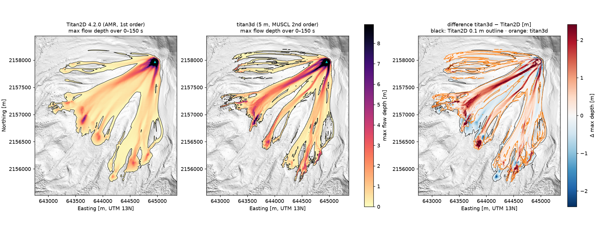
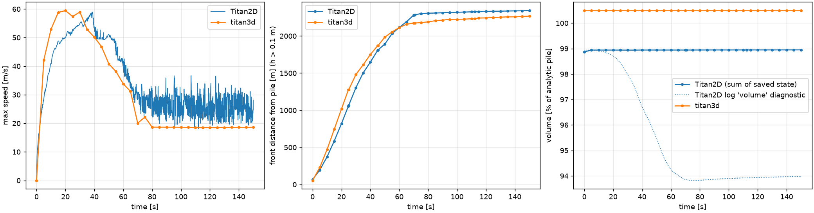

# titan3d vs Titan2D — Colima Coulomb example

Side-by-side run of Titan2D 4.2.0 and titan3d (main @ `c58b18e`) on Titan2D's own bundled
example `share/titan2d_examples/colimafinemini/Coulomb_GeoTIFF`, with matched inputs.
Run on 2026-10-07 on a 2-core Linux machine.

## Setup

| | Titan2D 4.2.0 | titan3d |
|---|---|---|
| DEM | `colimafinemini.geotiff`, 5 m, 900 × 900, EPSG:32613 | same file, used as-is (no reprojection) |
| Mesh | AMR, 16 cells across at start; cells in the flow 3.96–31.7 m | uniform 5 m (and 10 m for sensitivity) |
| Scheme | first order (`order='First'`, as in the example) | MUSCL-minmod 2nd order, hydrostatic reconstruction, Rusanov, SSP-RK2 |
| Rheology | Coulomb, φ_bed 27°, φ_int 37° | same; Savage–Hutter k; curvature on |
| Pile | cylinder H 30 m, R 55 m at (644956, 2157970) | same cylinder rasterized on the grid |
| Time | 150 s (`max_time=150`) | 150 s |
| Threads | OpenMP, 2 | Numba, 1 |

Only change to Titan2D's example: `max_time=150` instead of `max_iter=5000`, and
`dtime=5` for snapshots (`titan2d_input.py`).

## Results




| Metric | Titan2D | titan3d 5 m | Difference |
|---|---|---|---|
| Initial volume (m³; analytic 285,100) | 281,878 (−1.1 %) | 286,500 (+0.5 %) | pile discretization |
| Mass conservation over 150 s | exact (saved state 281,878 → 282,102) | exact | — |
| Peak speed | 59.0 m/s | 59.5 m/s | +0.8 % |
| Runout from pile centre (max depth > 0.1 m) | 2,342 m | 2,268 m | −3.2 % |
| Mobility H/L (tan φ_bed = 0.510) | 0.540 | 0.548 | +1.4 % |
| Inundated area, max depth > 0.1 m | 2.13 km² | 1.73 km² | −19 % |
| Inundated area, max depth > 1 m | 0.44 km² | 0.64 km² | +45 % |
| Footprint overlap (Jaccard) at 0.1 / 0.5 / 1 m | — | — | 0.67 / 0.60 / 0.52 |
| Deposit centroid distance from pile (t = 150 s) | 1,622 m | 1,660 m | centroids 71 m apart |
| Max deposit thickness (t = 150 s) | 3.1 m | 8.7 m | — |
| Wall time | 22 min | 89 s (10 m: 12 s) | ~15× faster |

All metrics come from `metrics.json`, produced by `compare.py`. Titan2D's max depth is its
`pileheightrecord` (1024 × 1024 grid, 3.96 m); titan3d's is sampled onto that grid.

## Interpretation

**Agreement on bulk dynamics.** Peak speed, front timing after ~55 s, runout and H/L agree
within a few percent. Both stop near the Coulomb energy line (H/L ≈ 0.54–0.55 vs tan 27° = 0.51).

**Difference in spreading.** Titan2D spreads thin sheets across the interfluves (more area
above 0.1 m, smoother lobes). titan3d keeps material in the gullies, so it is thicker there
(more area above 1 m, deposits up to 8.7 m vs 3.1 m) and the front advances ~25 % faster
in the first 20 s. Likely causes, in order of expected weight:

1. **Numerical diffusion.** Titan2D runs first order on AMR cells up to 32 m inside the
   flow; titan3d is second order on 5 m cells. First-order schemes smear thin margins
   laterally and slow the early front.
2. **Internal-friction shear term.** Titan2D includes `sgn(∂u/∂y) k ∂(g h)/∂y sin φ_int`;
   titan3d does not yet (`wiki/Titan2D.md`). It resists lateral shear and spreading.
3. **Initial volume.** Titan2D starts with 1.6 % less material than titan3d.

**The 0.1 m outline is resolution-sensitive on this DEM.** titan3d at 10 m vs 5 m gives the
same Jaccard (0.67) as titan3d vs Titan2D, and the farthest front switches to a different
lobe (2,489 m, west). Footprint comparisons on this terrain need a grid convergence check
before differences are attributed to physics.

**Neither run has fully stopped at 150 s.** titan3d's late max speed (18.6 m/s) is a
1–3 cm film draining down a 40.6° wall, steeper than φ_bed (`probe_umax.py`); ~5 % of the
volume still moves > 1 m/s. Titan2D's max speed fluctuates at 20–35 m/s over the same period.

**Titan2D log "volume" is not mass.** The `volume is …` line in Titan2D's log drops ~6 %,
but summing the saved state (cell area × pile height) stays at 282,1xx m³ throughout. The
log value is a diagnostic that excludes some cells; do not use it for mass balance.

## Next steps

1. Re-run Titan2D with `order='Second'` to separate numerical diffusion from model physics.
2. Implement the internal-friction shear term in titan3d and re-compare spreading.
3. titan3d grid convergence at 2.5 / 5 / 10 m for the footprint metrics.
4. Turn the agreed metrics (peak speed, runout, H/L, mass) into a regression test with
   tolerances, using these Titan2D numbers as the reference.

## Reproduce

```bash
bash build_titan2d.sh ~/titan2d_wsp                     # ~2 min build on Ubuntu 24.04
cp ~/titan2d_wsp/src/share/titan2d_examples/dem/colimafinemini.geotiff .
OMP_NUM_THREADS=2 ~/titan2d_wsp/inst/bin/titan titan2d_input.py > run.log   # in a run dir with the DEM
cd ../../../backend
COLIMA_DEM=/path/to/colimafinemini.geotiff uv run python ../docs/validation/titan2d-colima/run_titan3d.py out_5m
COLIMA_DEM=... uv run python ../docs/validation/titan2d-colima/run_titan3d.py out_10m --dx 10
uv run --with matplotlib --with h5py python ../docs/validation/titan2d-colima/compare.py T2D_RUN_DIR out_5m out_10m results/
```
