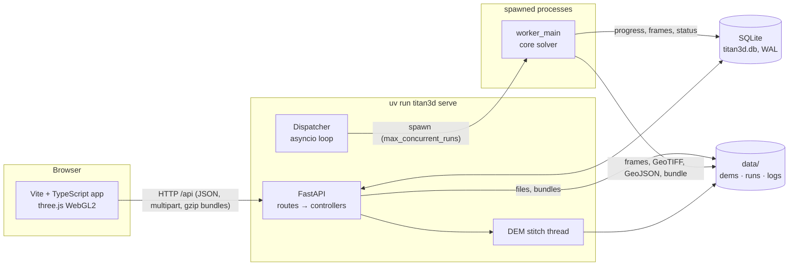
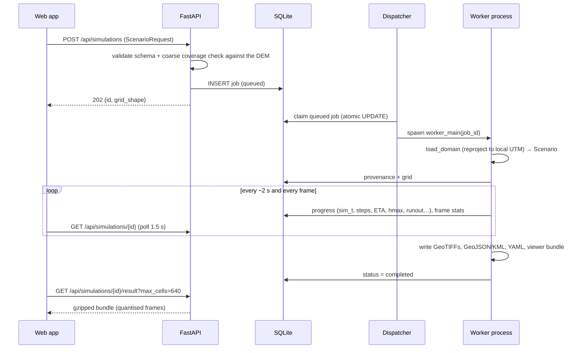

# Architecture

titan3d is one Python process (FastAPI + uvicorn) that serves the API and the built web UI, plus one spawned worker process per running simulation. State lives in a SQLite database and a data directory. Nothing else is required. nginx and Docker are optional.



## Layers and rules

| Layer | Package | May import | Never imports |
|---|---|---|---|
| Core computation | `titan3d.core` | NumPy, Numba, rasterio | FastAPI, pydantic, SQLite, YAML |
| Persistence | `titan3d.db` | sqlite3 | FastAPI, core internals |
| API | `titan3d.api` (`routes` → `controllers` → `core` / `db`; `schemas`; `workers`) | everything | — |
| Entry points | `titan3d.cli`, `titan3d.api.main:create_app` | everything | — |
| Frontend | `frontend/src` | three.js, proj4, generated API types | backend code |

- **Routes** only translate HTTP. **Controllers** hold the logic and raise typed `AppError`s (400/404/409/413/422). The core works on plain dataclasses (`Scenario`, `Grid`, `FlowParams`).
- `ScenarioRequest` (pydantic) is the single validation source for the API, YAML files and the CLI.
- `tests/test_imports.py` imports every module in a fresh interpreter, which catches circular imports.

## A simulation, end to end



- **Cancel** sets `cancel_requested`. The worker polls it every second and stops with status `cancelled`.
- **Restart safety:** workers are daemonic `spawn` processes. On startup, jobs still marked `running` become `interrupted`.
- **Concurrency:** `max_concurrent_runs` (default 1), because each run uses every core through Numba.

## A DEM upload

1. `POST /api/dems` streams the tiles to `data/dems/<id>/tiles/`, enforcing size and type limits, and creates a `processing` row.
2. A stitching thread runs `core.dem.stitch_tiles`: it validates and resolves the CRS, merges to float32 with NaN nodata, and writes a tiled, deflate-compressed GeoTIFF. It then computes the metadata: bounds, resolution, NaN fraction, highest point and SHA-256.
3. The row becomes `ready`, or `failed` with a plain-language error. The UI polls until then.
4. `GET /api/dems/{id}/preview` builds, once per detail level, a terrain preview in the DEM's central UTM zone. It is quantised uint16 elevation plus a valid-data mask.

## Storage

```
data/                         (project root, sibling to backend/; TITAN3D_DATA_DIR)
  titan3d.db                  SQLite: meta, dems, jobs, job_frames (WAL)
  dems/<dem id>/              tiles/, mosaic.tif, preview_<N>.json.gz
  runs/<run id>/              frames/NNNN.npz, grid.npz, maxima.npz, stats.json, meta.json,
                              summary.json, scenario.yaml, max_depth.tif, max_speed.tif,
                              inundation.geojson, inundation.kml, bundle_<N>.json.gz, run.log
  logs/titan3d.log            rotating server log
```

## Conventions

- **Grids:** arrays are `[j, i] = [y, x]`, with `j` increasing northward. Cell centres are in CRS metres (local UTM chosen from the anchor: EPSG:327zz south, 326zz north). `Grid.x0, y0` is the south-west cell centre.
- **three.js world (km):** `X = east`, `Z = −north`, `Y = (b − zmin)·vex`. Triangles are wound counter-clockwise seen from above (`a,b,c / b,d,c`).
- **Time:** frames at `t = 0, Δt_out, …, t_end`. Per-frame stats: `t, steps, vol, vol_out, released_m3, hmax, umax, area (km², h > 0.1 m), runout (m from the first source)`.
- **Bundles** (browser playback): depth is `uint8 = round(255·sqrt(h/hmax))` and speed is `uint8 = round(255·|u|/vmax)`, zlib-compressed and base64-encoded. Grids larger than the detail level are reduced by block maximum (depth, speed) and block mean (terrain).

## Key design decisions

| Decision | Why |
|---|---|
| Active-window solver | Flows cover a small part of the domain for most of a run; computing only the wet bounding box is exact and gives large speed-ups. |
| Numba kernels with a NumPy reference | About 13× faster (float64) and about 28× (float32) at 1 M cells, with a parity test against readable NumPy. |
| Spawned worker processes | Long CPU-bound runs never block the API, and cancel and crash handling are isolated. |
| SQLite (WAL) with short-lived connections | Zero-ops persistence shared by API threads and worker processes. |
| Heights in the vertex shader; frames as RG8 textures | Vertical exaggeration is a uniform, and playback uploads two frames instead of rewriting vertex buffers. |
| Plan view is an orthographic, north-up figure | Map furniture (graticule, scale bar) is exact only in plan view; 3D is labelled "not to scale". |
| FastAPI serves `frontend/dist` | One command runs everything; nginx is optional (`deploy/nginx.conf.example`). |
